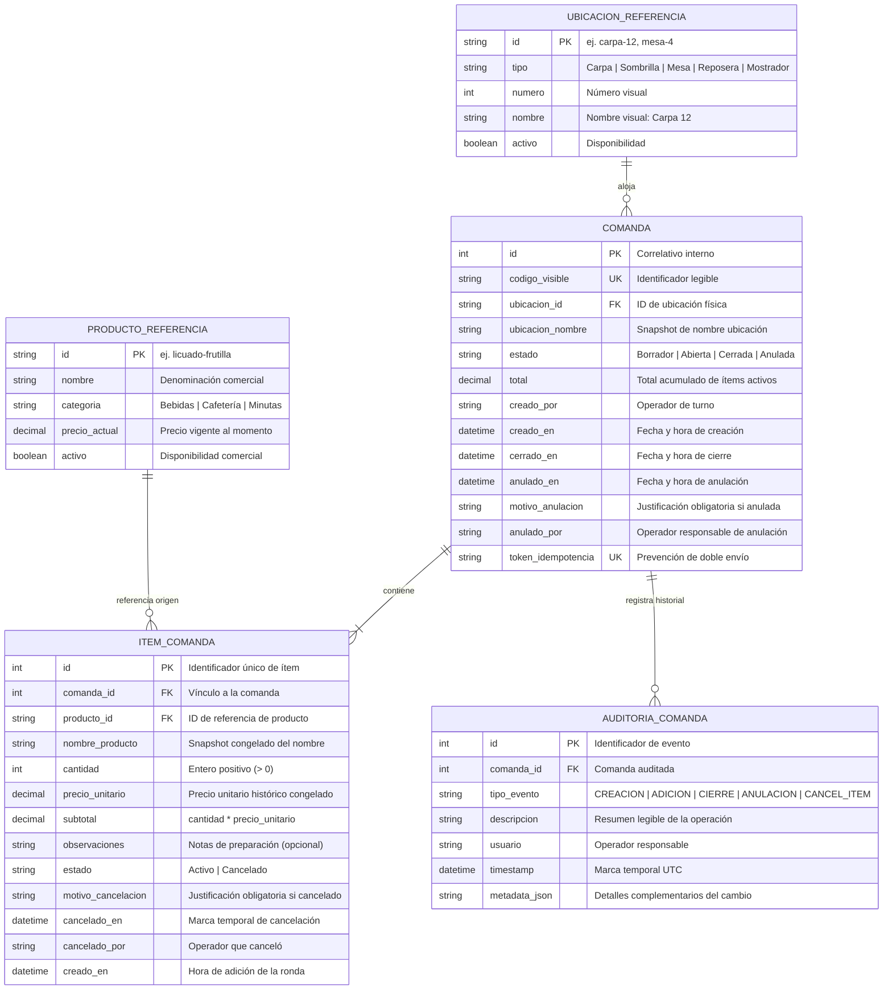
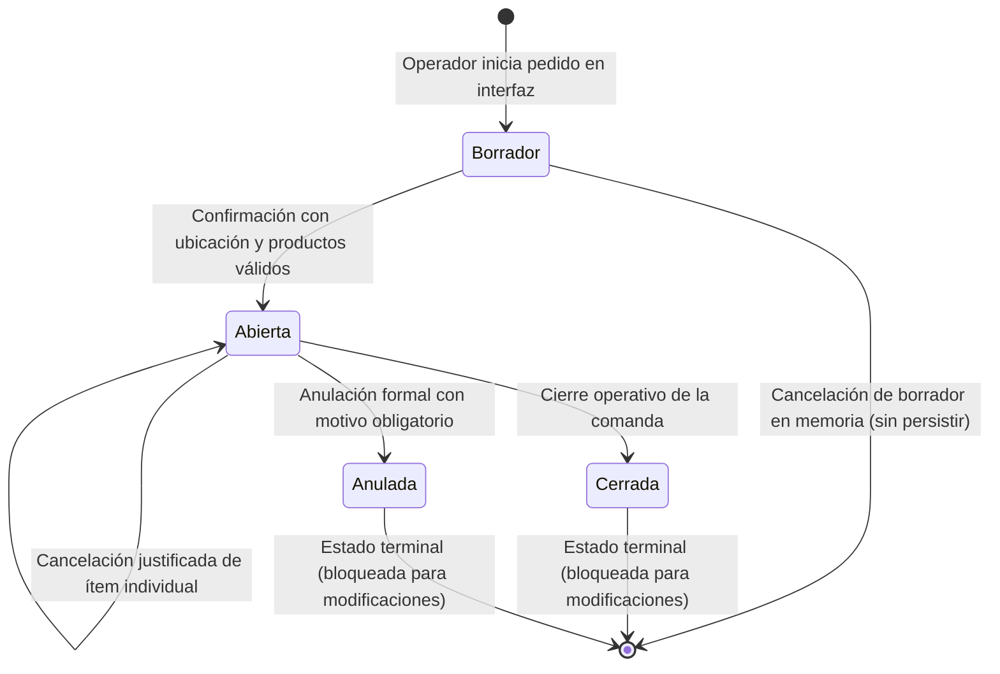

# Data Model: Gestión de Comandas

**Feature**: `001-gestion-comandas`  
**Date**: 2026-10-26  
**Status**: Completed  

Este documento define las entidades, atributos, relaciones, reglas de validación y el esquema de persistencia local en SQLite para el módulo de Gestión de Comandas, garantizando la inmutabilidad de precios históricos, la trazabilidad auditable y la resiliencia operativa.

---

## 1. Diagrama Entidad-Relación Conceptual



---

## 2. Máquina de Estados de Comanda



### Matriz de Transiciones y Reglas de Negocio

| Estado Origen | Evento / Acción | Estado Destino | Reglas y Validaciones |
| :--- | :--- | :--- | :--- |
| `[Nuevo]` | Iniciar carga | `Borrador` | Estado efímero en UI antes de confirmación. |
| `Borrador` | Confirmar comanda | `Abierta` | Requiere: ubicación válida + al menos 1 ítem con cantidad > 0 + cálculo de total. |
| `Abierta` | Adición de productos | `Abierta` | Se anexan nuevos ítems con marca temporal actual. Se recalcula el total acumulado. |
| `Abierta` | Cancelar ítem | `Abierta` | Requiere motivo obligatorio. Ítem pasa a `Cancelado`. Se resta del total acumulado. |
| `Abierta` | Cerrar comanda | `Cerrada` | Bloquea la comanda para nuevos pedidos. Queda lista para liquidación en módulo de Cuentas. |
| `Abierta` | Anular comanda | `Anulada` | Requiere motivo obligatorio. La comanda y sus ítems se conservan intactos (soft-cancel). |
| `Cerrada` | Cualquier edición | *Rechazado* | Error: `COMANDA_CERRADA`. No admite adición ni cancelación de ítems. |
| `Anulada` | Cualquier edición | *Rechazado* | Error: `COMANDA_ANULADA`. Prohibida cualquier modificación. |

---

## 3. Esquema Físico Relacional SQLite (DDL)

```sql
-- Habilitar integridad referencial y modo WAL
PRAGMA foreign_keys = ON;
PRAGMA journal_mode = WAL;
PRAGMA synchronous = NORMAL;

-- Tabla de ubicaciones físicas de referencia
CREATE TABLE IF NOT EXISTS ubicaciones_referencia (
    id TEXT PRIMARY KEY,
    tipo TEXT NOT NULL CHECK(tipo IN ('Carpa', 'Sombrilla', 'Mesa', 'Reposera', 'Mostrador')),
    numero INTEGER NOT NULL,
    nombre TEXT NOT NULL,
    activo INTEGER NOT NULL DEFAULT 1 CHECK(activo IN (0, 1))
);

-- Tabla de catálogo de productos de referencia
CREATE TABLE IF NOT EXISTS productos_referencia (
    id TEXT PRIMARY KEY,
    nombre TEXT NOT NULL,
    categoria TEXT NOT NULL,
    precio_actual REAL NOT NULL CHECK(precio_actual >= 0),
    activo INTEGER NOT NULL DEFAULT 1 CHECK(activo IN (0, 1))
);

-- Tabla principal de comandas
CREATE TABLE IF NOT EXISTS comandas (
    id INTEGER PRIMARY KEY AUTOINCREMENT,
    codigo_visible TEXT NOT NULL UNIQUE,
    ubicacion_id TEXT NOT NULL,
    ubicacion_nombre TEXT NOT NULL,
    estado TEXT NOT NULL CHECK(estado IN ('Borrador', 'Abierta', 'Cerrada', 'Anulada')),
    total REAL NOT NULL DEFAULT 0.0 CHECK(total >= 0),
    creado_por TEXT NOT NULL,
    creado_en TEXT NOT NULL,       -- ISO-8601 UTC (YYYY-MM-DDTHH:MM:SSZ)
    cerrado_en TEXT,               -- ISO-8601 UTC
    anulado_en TEXT,               -- ISO-8601 UTC
    motivo_anulacion TEXT,
    anulado_por TEXT,
    token_idempotencia TEXT UNIQUE,
    FOREIGN KEY (ubicacion_id) REFERENCES ubicaciones_referencia(id) ON UPDATE CASCADE
);

CREATE INDEX IF NOT EXISTS idx_comandas_estado ON comandas(estado);
CREATE INDEX IF NOT EXISTS idx_comandas_ubicacion ON comandas(ubicacion_id);
CREATE INDEX IF NOT EXISTS idx_comandas_creado_en ON comandas(creado_en);

-- Tabla de ítems de comanda
CREATE TABLE IF NOT EXISTS items_comanda (
    id INTEGER PRIMARY KEY AUTOINCREMENT,
    comanda_id INTEGER NOT NULL,
    producto_id TEXT NOT NULL,
    nombre_producto TEXT NOT NULL,     -- Congelado al momento del pedido
    cantidad INTEGER NOT NULL CHECK(cantidad > 0),
    precio_unitario REAL NOT NULL CHECK(precio_unitario >= 0), -- Congelado al momento del pedido
    subtotal REAL NOT NULL CHECK(subtotal >= 0),               -- cantidad * precio_unitario
    observaciones TEXT,
    estado TEXT NOT NULL CHECK(estado IN ('Activo', 'Cancelado')) DEFAULT 'Activo',
    motivo_cancelacion TEXT,
    cancelado_en TEXT,
    cancelado_por TEXT,
    creado_en TEXT NOT NULL,           -- Permite conocer la hora de cada ronda
    FOREIGN KEY (comanda_id) REFERENCES comandas(id) ON DELETE RESTRICT,
    FOREIGN KEY (producto_id) REFERENCES productos_referencia(id) ON UPDATE CASCADE
);

CREATE INDEX IF NOT EXISTS idx_items_comanda_id ON items_comanda(comanda_id);

-- Tabla de auditoría histórica inmutable
CREATE TABLE IF NOT EXISTS auditoria_comandas (
    id INTEGER PRIMARY KEY AUTOINCREMENT,
    comanda_id INTEGER NOT NULL,
    tipo_evento TEXT NOT NULL CHECK(tipo_evento IN (
        'CREACION', 
        'ADICION_ITEMS', 
        'CIERRE', 
        'ANULACION_COMANDA', 
        'CANCELACION_ITEM'
    )),
    descripcion TEXT NOT NULL,
    usuario TEXT NOT NULL,
    timestamp TEXT NOT NULL,           -- ISO-8601 UTC
    metadata_json TEXT,
    FOREIGN KEY (comanda_id) REFERENCES comandas(id) ON DELETE RESTRICT
);

CREATE INDEX IF NOT EXISTS idx_auditoria_comanda_id ON auditoria_comandas(comanda_id);
```

---

## 4. Reglas de Validación de Integridad (Normativas)

1. **Inmutabilidad de Importes Históricos**:
   - El campo `precio_unitario` de `items_comanda` almacena el valor numérico exacto vigente al momento de confirmarse el ítem.
   - Cualquier modificación futura sobre `productos_referencia.precio_actual` **NO** afecta ni actualiza las filas existentes en `items_comanda`.
2. **Cálculo Consistente de Subtotales y Totales**:
   - `subtotal = cantidad * precio_unitario`.
   - `total de comanda = SUM(subtotal)` para todos los ítems de esa comanda cuyo `estado == 'Activo'`.
   - Si un ítem pasa a `Cancelado`, su subtotal deja de sumarse al `total` de la comanda.
3. **Validación de Bajas y Anulaciones (Soft-Delete)**:
   - Está terminantemente prohibido ejecutar `DELETE` sobre las tablas `comandas` o `items_comanda`.
   - Toda anulación de comanda exige `motivo_anulacion NOT NULL` y de longitud mínima > 3 caracteres.
   - Toda cancelación de ítem exige `motivo_cancelacion NOT NULL` y de longitud mínima > 3 caracteres.
4. **Resistencia a Duplicación (Idempotencia)**:
   - El campo `token_idempotencia` en `comandas` previene que una misma solicitud enviada por doble pulsación cree dos registros en la base de datos.

