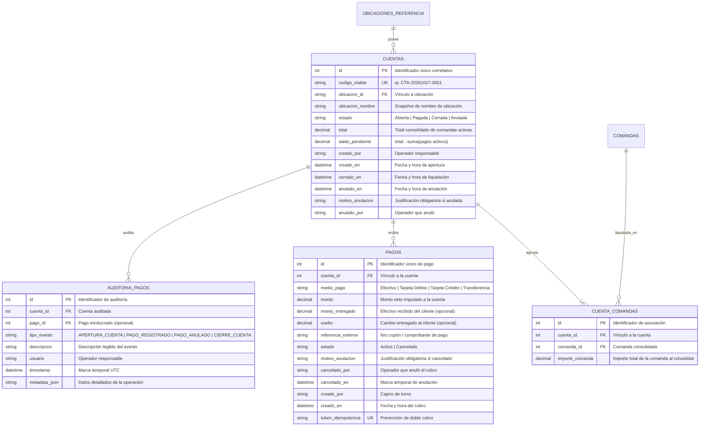
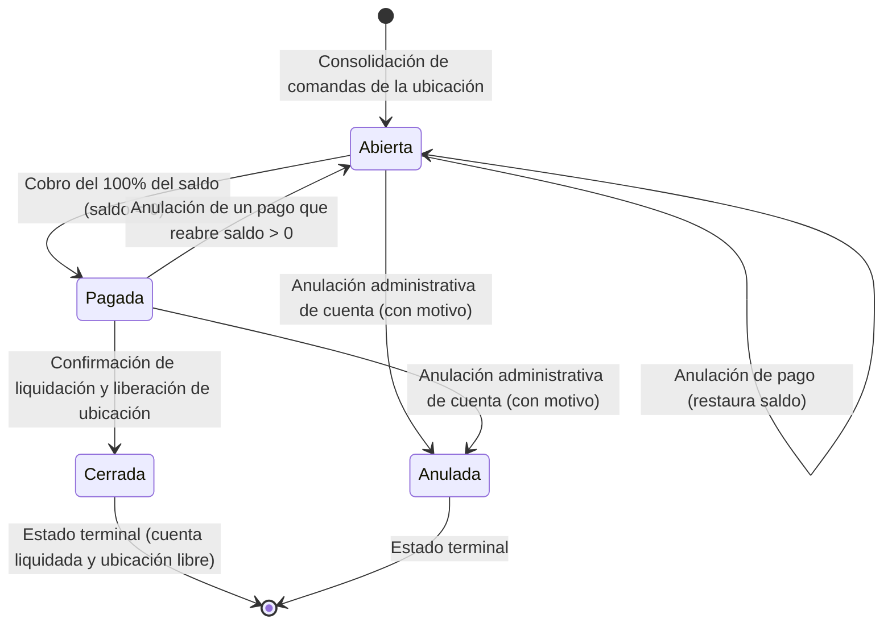

# Data Model: Gestión de Cuentas y Pagos

**Feature**: `002-gestion-cuentas-pagos`  
**Date**: 2026-10-27  
**Status**: Completed  

Este documento define el modelo de datos relacional para la consolidación de consumos, la gestión de pagos multimedio y el control de caja en SQLite local.

---

## 1. Diagrama Entidad-Relación



---

## 2. Máquina de Estados de la Cuenta



### Reglas de Transición
1. **Apertura**: Al crear la cuenta a partir de comandas activas, el estado inicial es `Abierta` con `saldo_pendiente = total`.
2. **Pago Parcial**: Si `monto_pago < saldo_pendiente`, la cuenta continúa en estado `Abierta` con el saldo actualizado.
3. **Liquidación Completa**: Cuando un pago reduce el saldo a exactamente `0,00`, la cuenta cambia automáticamente a `Pagada`.
4. **Liberación de Ubicación**: Solo una cuenta en estado `Pagada` (saldo = $0,00) puede pasar a `Cerrada` y liberar la ubicación física para nuevos clientes.
5. **Reapertura por Anulación**: Si se anula un pago en una cuenta `Pagada`, el saldo vuelve a ser mayor a $0 y la cuenta regresa automáticamente a estado `Abierta`.

---

## 3. Esquema Físico Relacional SQLite (DDL)

```sql
-- Tabla de Cuentas consolidadas
CREATE TABLE IF NOT EXISTS cuentas (
    id INTEGER PRIMARY KEY AUTOINCREMENT,
    codigo_visible TEXT NOT NULL UNIQUE,
    ubicacion_id TEXT NOT NULL,
    ubicacion_nombre TEXT NOT NULL,
    estado TEXT NOT NULL CHECK(estado IN ('Abierta', 'Pagada', 'Cerrada', 'Anulada')),
    total REAL NOT NULL DEFAULT 0.0 CHECK(total >= 0),
    saldo_pendiente REAL NOT NULL DEFAULT 0.0 CHECK(saldo_pendiente >= 0),
    creado_por TEXT NOT NULL,
    creado_en TEXT NOT NULL,       -- ISO-8601 UTC
    cerrado_en TEXT,               -- ISO-8601 UTC
    anulado_en TEXT,               -- ISO-8601 UTC
    motivo_anulacion TEXT,
    anulado_por TEXT,
    FOREIGN KEY (ubicacion_id) REFERENCES ubicaciones_referencia(id) ON UPDATE CASCADE
);

CREATE INDEX IF NOT EXISTS idx_cuentas_estado ON cuentas(estado);
CREATE INDEX IF NOT EXISTS idx_cuentas_ubicacion ON cuentas(ubicacion_id);

-- Tabla asociativa Cuenta - Comandas
CREATE TABLE IF NOT EXISTS cuenta_comandas (
    id INTEGER PRIMARY KEY AUTOINCREMENT,
    cuenta_id INTEGER NOT NULL,
    comanda_id INTEGER NOT NULL,
    importe_comanda REAL NOT NULL CHECK(importe_comanda >= 0),
    FOREIGN KEY (cuenta_id) REFERENCES cuentas(id) ON DELETE CASCADE,
    FOREIGN KEY (comanda_id) REFERENCES comandas(id) ON DELETE RESTRICT,
    UNIQUE(cuenta_id, comanda_id)
);

CREATE INDEX IF NOT EXISTS idx_cuenta_comandas_cuenta ON cuenta_comandas(cuenta_id);
CREATE INDEX IF NOT EXISTS idx_cuenta_comandas_comanda ON cuenta_comandas(comanda_id);

-- Tabla de Pagos individuales
CREATE TABLE IF NOT EXISTS pagos (
    id INTEGER PRIMARY KEY AUTOINCREMENT,
    cuenta_id INTEGER NOT NULL,
    medio_pago TEXT NOT NULL CHECK(medio_pago IN ('Efectivo', 'Tarjeta Débito', 'Tarjeta Crédito', 'Transferencia')),
    monto REAL NOT NULL CHECK(monto > 0),
    monto_entregado REAL CHECK(monto_entregado >= monto),
    vuelto REAL CHECK(vuelto >= 0),
    referencia_externa TEXT,
    estado TEXT NOT NULL CHECK(estado IN ('Activo', 'Cancelado')) DEFAULT 'Activo',
    motivo_anulacion TEXT,
    cancelado_por TEXT,
    cancelado_en TEXT,
    creado_por TEXT NOT NULL,
    creado_en TEXT NOT NULL,
    token_idempotencia TEXT UNIQUE,
    FOREIGN KEY (cuenta_id) REFERENCES cuentas(id) ON DELETE RESTRICT
);

CREATE INDEX IF NOT EXISTS idx_pagos_cuenta ON pagos(cuenta_id);
CREATE INDEX IF NOT EXISTS idx_pagos_estado ON pagos(estado);
CREATE INDEX IF NOT EXISTS idx_pagos_creado_en ON pagos(creado_en);

-- Tabla de Auditoría de Pagos y Caja
CREATE TABLE IF NOT EXISTS auditoria_pagos (
    id INTEGER PRIMARY KEY AUTOINCREMENT,
    cuenta_id INTEGER NOT NULL,
    pago_id INTEGER,
    tipo_evento TEXT NOT NULL CHECK(tipo_evento IN (
        'APERTURA_CUENTA', 
        'PAGO_REGISTRADO', 
        'PAGO_ANULADO', 
        'CIERRE_CUENTA'
    )),
    descripcion TEXT NOT NULL,
    usuario TEXT NOT NULL,
    timestamp TEXT NOT NULL,
    metadata_json TEXT,
    FOREIGN KEY (cuenta_id) REFERENCES cuentas(id) ON DELETE RESTRICT,
    FOREIGN KEY (pago_id) REFERENCES pagos(id) ON DELETE RESTRICT
);

CREATE INDEX IF NOT EXISTS idx_auditoria_pagos_cuenta ON auditoria_pagos(cuenta_id);
```

