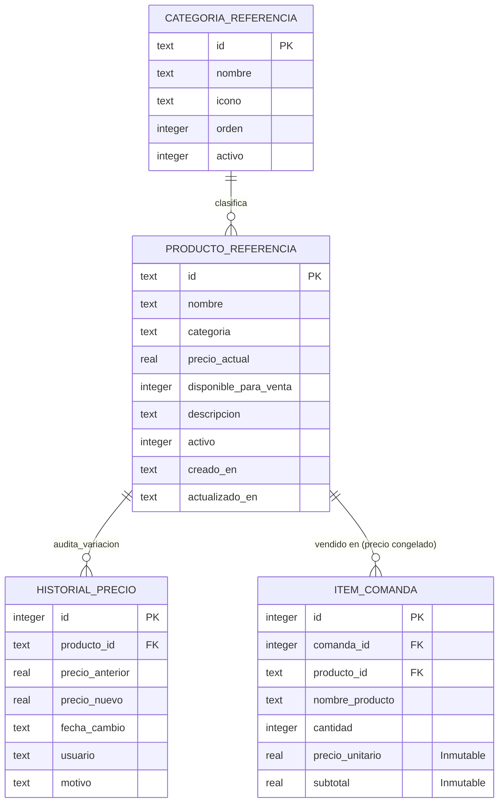

# Data Model: Gestión de Catálogo de Productos y Precios

**Feature**: `003-gestion-catalogo-productos-precios`  
**Date**: 2026-10-27  
**Storage Engine**: SQLite 3 (Modo WAL, Foreign Keys activas)

---

## 1. Diagrama Entidad-Relación



---

## 2. Definición Detallada de Entidades

### 2.1. `ProductoReferencia`
Representa cada ítem gastronómico ofrecido a los clientes del balneario.

| Atributo | Tipo SQLite | Restricciones | Descripción |
| :--- | :--- | :--- | :--- |
| `id` | `TEXT` | `PRIMARY KEY` | Identificador slug unívoco (ej: `licuado-frutilla`, `tostado-mixto`). |
| `nombre` | `TEXT` | `NOT NULL` | Denominación comercial visible para clientes y personal. |
| `categoria` | `TEXT` | `NOT NULL` | Categoría a la que pertenece (`Bebidas`, `Minutas`, `Cafetería`, etc.). |
| `precio_actual` | `REAL` | `NOT NULL CHECK(precio_actual > 0)` | Precio vigente de venta unitario. |
| `disponible_para_venta` | `INTEGER` | `NOT NULL DEFAULT 1 CHECK(disponible_para_venta IN (0, 1))` | Control rápido de stock (`1` = disponible, `0` = pausado/agotado). |
| `descripcion` | `TEXT` | Opcional | Detalle de ingredientes o aclaraciones para cocina. |
| `activo` | `INTEGER` | `NOT NULL DEFAULT 1 CHECK(activo IN (0, 1))` | Baja lógica (`1` = activo, `0` = descontinuado). |
| `creado_en` | `TEXT` | `NOT NULL` | Marca temporal ISO-8601 de creación. |
| `actualizado_en` | `TEXT` | `NOT NULL` | Marca temporal ISO-8601 de última modificación. |

### 2.2. `CategoriaReferencia`
Organiza los productos en la barra y pantalla táctil para selección ágil.

| Atributo | Tipo SQLite | Restricciones | Descripción |
| :--- | :--- | :--- | :--- |
| `id` | `TEXT` | `PRIMARY KEY` | Clave unívoca en minúsculas (ej: `bebidas`, `minutas`, `cafeteria`). |
| `nombre` | `TEXT` | `NOT NULL` | Nombre visible de la pestaña en el menú. |
| `icono` | `TEXT` | Opcional | Emoji o nombre de icono Lucide para presentación visual. |
| `orden` | `INTEGER` | `NOT NULL DEFAULT 0` | Número de orden relativo para posicionamiento visual. |
| `activo` | `INTEGER` | `NOT NULL DEFAULT 1 CHECK(activo IN (0, 1))` | `1` = visible, `0` = oculta. |

### 2.3. `HistorialPrecio`
Bitácora inmutable de variaciones de precios comerciales con trazabilidad del usuario responsable.

| Atributo | Tipo SQLite | Restricciones | Descripción |
| :--- | :--- | :--- | :--- |
| `id` | `INTEGER` | `PRIMARY KEY AUTOINCREMENT` | Identificador secuencial de la variación. |
| `producto_id` | `TEXT` | `NOT NULL`, `FOREIGN KEY` | Referencia al producto modificado. |
| `precio_anterior` | `REAL` | `NOT NULL CHECK(precio_anterior >= 0)` | Precio previo a la actualización. |
| `precio_nuevo` | `REAL` | `NOT NULL CHECK(precio_nuevo > 0)` | Nuevo precio establecido. |
| `fecha_cambio` | `TEXT` | `NOT NULL` | Marca temporal ISO-8601 de la modificación. |
| `usuario` | `TEXT` | `NOT NULL` | Operador/administrador que aplicó el cambio. |
| `motivo` | `TEXT` | Opcional | Razón del cambio (ej: "Ajuste inflacionario quincena enero"). |

---

## 3. Sentencias DDL de Migración SQLite

```sql
-- 1. Categorías del catálogo gastronómico
CREATE TABLE IF NOT EXISTS categorias_referencia (
    id TEXT PRIMARY KEY,
    nombre TEXT NOT NULL,
    icono TEXT,
    orden INTEGER NOT NULL DEFAULT 0,
    activo INTEGER NOT NULL DEFAULT 1 CHECK(activo IN (0, 1))
);

CREATE INDEX IF NOT EXISTS idx_categorias_orden ON categorias_referencia(orden, activo);

-- 2. Asegurar campos en productos_referencia (migración aditiva idempotente)
-- Nota: La tabla ya existe desde Feature 001. Se agregan las columnas adicionales si faltan:
-- disponible_para_venta, descripcion, creado_en, actualizado_en.

-- 3. Historial inmutable de precios
CREATE TABLE IF NOT EXISTS historial_precios (
    id INTEGER PRIMARY KEY AUTOINCREMENT,
    producto_id TEXT NOT NULL,
    precio_anterior REAL NOT NULL CHECK(precio_anterior >= 0),
    precio_nuevo REAL NOT NULL CHECK(precio_nuevo > 0),
    fecha_cambio TEXT NOT NULL,
    usuario TEXT NOT NULL,
    motivo TEXT,
    FOREIGN KEY (producto_id) REFERENCES productos_referencia(id) ON UPDATE CASCADE ON DELETE RESTRICT
);

CREATE INDEX IF NOT EXISTS idx_historial_precios_producto ON historial_precios(producto_id);
CREATE INDEX IF NOT EXISTS idx_historial_precios_fecha ON historial_precios(fecha_cambio);
```

---

## 4. Invariantes y Reglas de Negocio Contables

1. **Invariante de Precio Histórico**:
   $$\forall \text{ item} \in \text{items\_comanda}, \quad \text{item.precio\_unitario} = \text{precio\_vigente}(\text{item.creado\_en})$$
   El precio unitario de una comanda emitida jamás se actualiza ante un cambio posterior en `productos_referencia.precio_actual`.

2. **Regla de Pausado Operativo**:
   Si $\text{producto.disponible\_para\_venta} = 0$, la API de comandería rechaza la adición de dicho producto en comandas nuevas arrojando el error `PRODUCTO_NO_DISPONIBLE`.

3. **Regla de Integridad Referencial**:
   No se permite la eliminación física (`DELETE`) de ningún producto de `productos_referencia`. La baja se efectúa siempre como baja lógica:
   $$\text{UPDATE productos\_referencia SET activo = 0 WHERE id = ?}$$

