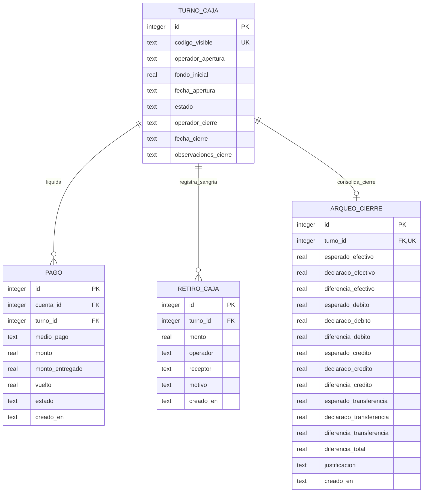

# Data Model: Gestión de Turnos de Caja y Arqueo Ciego

**Feature**: `004-gestion-turnos-arqueo-caja`  
**Date**: 2026-10-27  
**Storage Engine**: SQLite 3 (Modo WAL, Foreign Keys activas)

---

## 1. Diagrama Entidad-Relación



---

## 2. Definición Detallada de Tablas y Esquemas DDL

### 2.1. `turnos_caja`
Controla el ciclo de vida de los turnos de cajeros en el mostrador del balneario.

| Campo | Tipo SQLite | Restricciones | Descripción |
| :--- | :--- | :--- | :--- |
| `id` | `INTEGER` | `PRIMARY KEY AUTOINCREMENT` | Clave interna correlativa. |
| `codigo_visible` | `TEXT` | `NOT NULL UNIQUE` | Formato legible `TRN-YYYYMMDD-NN` (ej: `TRN-20261027-01`). |
| `operador_apertura` | `TEXT` | `NOT NULL` | Identificador del cajero que abre la caja. |
| `fondo_inicial` | `REAL` | `NOT NULL CHECK(fondo_inicial >= 0)` | Efectivo para cambio al inicio del turno. |
| `fecha_apertura` | `TEXT` | `NOT NULL` | Marca temporal ISO-8601 de inicio de jornada. |
| `estado` | `TEXT` | `NOT NULL CHECK(estado IN ('Abierto', 'Cerrado'))` | Estado operativo del turno. |
| `operador_cierre` | `TEXT` | Opcional | Cajero o supervisor que realiza el arqueo de cierre. |
| `fecha_cierre` | `TEXT` | Opcional | Marca temporal ISO-8601 del arqueo definitivo. |
| `observaciones_cierre` | `TEXT` | Opcional | Notas o comentarios generales del cierre. |

#### Índices de `turnos_caja`:
```sql
CREATE UNIQUE INDEX IF NOT EXISTS idx_un_solo_turno_abierto ON turnos_caja(estado) WHERE estado = 'Abierto';
CREATE INDEX IF NOT EXISTS idx_turnos_caja_fecha ON turnos_caja(fecha_apertura);
CREATE INDEX IF NOT EXISTS idx_turnos_caja_estado ON turnos_caja(estado);
```

---

### 2.2. `retiros_caja` (Sangrías de Efectivo)
Asienta las salidas seguras de dinero de la gaveta hacia la caja de seguridad.

| Campo | Tipo SQLite | Restricciones | Descripción |
| :--- | :--- | :--- | :--- |
| `id` | `INTEGER` | `PRIMARY KEY AUTOINCREMENT` | Clave interna del retiro. |
| `turno_id` | `INTEGER` | `NOT NULL, FOREIGN KEY` | Vinculación estricta con el turno activo. |
| `monto` | `REAL` | `NOT NULL CHECK(monto > 0)` | Importe de dinero extraído. |
| `operador` | `TEXT` | `NOT NULL` | Cajero que entrega el efectivo de la gaveta. |
| `receptor` | `TEXT` | `NOT NULL` | Persona o supervisor que recibe el sobre/bolsa. |
| `motivo` | `TEXT` | `NOT NULL` | Razón de la extracción (ej: "Traslado a caja fuerte"). |
| `creado_en` | `TEXT` | `NOT NULL` | Marca temporal ISO-8601. |

#### Restricciones Foráneas e Índices:
```sql
FOREIGN KEY (turno_id) REFERENCES turnos_caja(id) ON DELETE RESTRICT;
CREATE INDEX IF NOT EXISTS idx_retiros_caja_turno ON retiros_caja(turno_id);
```

---

### 2.3. `arqueos_cierre` (Auditoría de Arqueo Ciego)
Almacena el resultado inmutable de la conciliación del turno.

| Campo | Tipo SQLite | Restricciones | Descripción |
| :--- | :--- | :--- | :--- |
| `id` | `INTEGER` | `PRIMARY KEY AUTOINCREMENT` | Clave interna del arqueo. |
| `turno_id` | `INTEGER` | `NOT NULL UNIQUE, FOREIGN KEY` | Turno al que pertenece el arqueo (1 a 1). |
| `esperado_efectivo` | `REAL` | `NOT NULL` | Fondo inicial + Cobros en efectivo - Retiros. |
| `declarado_efectivo`| `REAL` | `NOT NULL CHECK(declarado_efectivo >= 0)` | Dinero contado físicamente en arqueo ciego. |
| `diferencia_efectivo`| `REAL`| `NOT NULL` | `declarado_efectivo - esperado_efectivo`. |
| `esperado_debito` | `REAL` | `NOT NULL DEFAULT 0` | Total cobrado en tarjeta de débito en el turno. |
| `declarado_debito` | `REAL` | `NOT NULL DEFAULT 0` | Total declarado de cupones de débito. |
| `esperado_credito` | `REAL` | `NOT NULL DEFAULT 0` | Total cobrado en tarjeta de crédito en el turno. |
| `declarado_credito`| `REAL` | `NOT NULL DEFAULT 0` | Total declarado de cupones de crédito. |
| `esperado_transferencia`| `REAL` | `NOT NULL DEFAULT 0`| Total cobros confirmados por transferencia/QR. |
| `declarado_transferencia`| `REAL`| `NOT NULL DEFAULT 0`| Total comprobantes de transferencia declarados. |
| `diferencia_total` | `REAL` | `NOT NULL` | Suma neta de todas las diferencias monetarias. |
| `justificacion` | `TEXT` | Opcional (obligatorio si desvío > $1.000) | Motivo explicativo del faltante o sobrante. |
| `creado_en` | `TEXT` | `NOT NULL` | Marca temporal ISO-8601 del arqueo. |

---

### 2.4. Modificación Aditiva en `pagos`
Se agrega la columna opcional `turno_id`:
```sql
ALTER TABLE pagos ADD COLUMN turno_id INTEGER REFERENCES turnos_caja(id) ON DELETE RESTRICT;
CREATE INDEX IF NOT EXISTS idx_pagos_turno_id ON pagos(turno_id);
```
Esto preserva intactos todos los pagos y auditorías generados en Feature 002.

